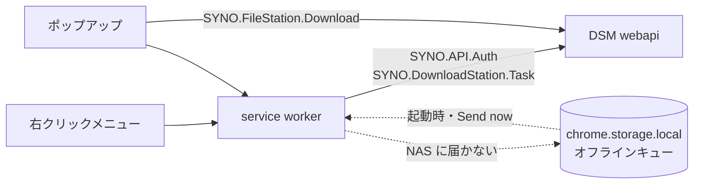

# Synology DownloadStation


Synology NAS の DownloadStation を、ブラウザを離れずに操作する Chrome 拡張です。ページやリンクを右クリックしてそのままダウンロードタスクに放り込み、ツールバーのポップアップから進捗・一時停止・再開・削除を扱えます。

[](https://github.com/solidlime/SynologyDS_Extension/actions/workflows/build.yml)
[](LICENSE)

[English](README.en.md) | 日本語

<!-- screenshot:hero — ポップアップのタスク一覧と、右クリックメニュー -->

## インストール

必要なものは Chrome 120 以降（Chromium 系ブラウザでも可）、DSM 5.x 以降を動かす Synology NAS、そして DownloadStation パッケージです。ストアには公開していないので、リリースの ZIP かソースからのビルドで入れます。

### リリースから入れる

1. [Releases](https://github.com/solidlime/SynologyDS_Extension/releases) から最新の `synology-ds-extension-vX.Y.Z.zip` をダウンロードする
2. ZIP を展開する
3. `chrome://extensions/` を開いて、右上の「デベロッパーモード」を有効にする
4. 「パッケージ化されていない拡張機能を読み込む」を押し、展開したフォルダを選ぶ

### ソースからビルドする

```bash
git clone https://github.com/solidlime/SynologyDS_Extension.git
cd SynologyDS_Extension
npm install
npm run build
```

`dist/` が拡張機能の実体です。`chrome://extensions/` の「パッケージ化されていない拡張機能を読み込む」で `dist/` を指定します。ソースを変更したら `npm run build` を実行し、拡張機能一覧の再読み込みボタンを押します。

## 初期設定

拡張機能のアイコンを押し、右上の歯車から設定画面を開きます。

| 項目 | 例 | 必須 |
|---|---|---|
| NAS URL | `https://192.168.1.100:5001` | はい |
| ユーザー名 | `admin` | はい |
| パスワード | — | はい |
| 既定の保存先 | `/downloads` | いいえ |

「接続テスト」を押すと、その場でログインを試せます。QuickConnect ID を入れた場合は、解決後の URL もここに表示されます。問題がなければ「設定を保存」を押してください。

### NAS URL の書き方

| 形式 | 例 |
|---|---|
| HTTPS | `https://192.168.1.100:5001` |
| HTTP | `http://nas:5000` |
| QuickConnect 直接 | `yourID.direct.quickconnect.to` |
| QuickConnect ID | `yourID` または `quickconnect.to/yourID` |

`http://` や `https://` を省いた場合、ドットもポートも含まない文字列（`yourID` など）は QuickConnect ID として扱われます。それ以外は `https://` が補われます。

## セルフ署名証明書

NAS が自己署名証明書を使っていると、`Cannot reach …` というエラーで止まります。Chrome が証明書を信頼していないためです。

1. Chrome で NAS の URL を直接開く（例: `https://192.168.1.100:5001`）
2. 警告画面の「詳細設定」から「安全でないページに進む」を選ぶ
3. 拡張機能から再接続する

HTTP で接続している場合は、この手順は不要です。

## 使い方

### 右クリックメニュー

| メニュー項目 | 右クリックする場所 | 送信される内容 |
|---|---|---|
| Send to DownloadStation | リンク | リンク先の URL |
| Send page URL to DownloadStation | ページ | 現在のページの URL |
| Send "%s" to DownloadStation | 選択したテキスト | 選択範囲（`http`、`https`、`ftp`、`magnet` のみ） |

未設定のまま送ろうとすると、通知が出て設定画面が開きます。送信に成功すると、URL の先頭 80 文字が通知に出ます。

### ポップアップ

ツールバーのアイコンを押すと、タスク一覧が開きます。5 秒ごとに自動更新されます。

- 「Active」タブ: 待機中、ダウンロード中、一時停止中、チェック中、展開中などをまとめて表示
- 「Finished」タブ: 完了とシード中
- 「Error」タブ: 失敗したタスク

各行のボタンで操作します。

| ボタン | 動き | 出る条件 |
|---|---|---|
| 再生 | 再開 | 一時停止中 |
| 一時停止 | 停止 | ダウンロード中・シード中 |
| ゴミ箱 | 削除 | 常時 |

下部の入力欄に URL や magnet リンクを貼って Enter を押すと、その場でタスクを追加できます。完了したタスクのファイル名をダブルクリックすると、ブラウザのダウンロードとして NAS から直接取得します。保存先は Chrome の既定のダウンロード先です。

### オフラインキュー

NAS に届かなかったタスク（回線が落ちている、NAS がスリープ中など）は、`chrome.storage.local` のキューに溜まります。

- ブラウザの起動時に自動で送信を試みます
- ポップアップに黄色いバナーが出ているときは、「Send now」で即座に流せます
- 送信できたものはキューから消えます
- NAS に届かないだけなら、そこで処理を止めて残りは次回に持ち越します
- NAS が受け付けないタスク（保存先が無い、タスク数が上限など）はキューから外し、通知で知らせます

## 機能

- 右クリックメニューからのタスク追加。リンク、ページ URL、選択テキストに対応
- ポップアップでの進捗表示、一時停止・再開・削除、タスク数のバッジ
- 完了ファイルのダブルクリック取得（`SYNO.FileStation.Download`）
- オフラインキューと再接続時の自動送信
- QuickConnect ID の解決。外部 IP、DDNS、FQDN、リレーホストの順に探して接続先を決める
- ログイン時の API 自動検出。DSM の世代によるパスとバージョンの違いを吸収する
- 設定画面の接続テストと、既定の保存先の指定

## 対応ブラウザ

| ブラウザ | 対応 |
|---|---|
| Chrome 120 以降 | 対応 |
| Edge などの Chromium 系 | 対応（未検証） |
| Firefox | 非対応 |

Manifest V3 の service worker と `chrome.*` 名前空間をそのまま使っているため、Firefox では動きません。

## 権限とプライバシー

| 権限 | 用途 |
|---|---|
| `contextMenus` | 右クリックメニューの 3 項目 |
| `storage` | 接続設定とオフラインキューの保存 |
| `notifications` | 送信結果とキューの通知 |
| `downloads` | 完了ファイルのブラウザへの取得 |
| `<all_urls>` | どのページからでも右クリック送信できるようにする |

送信先は次の 2 つだけです。

- NAS 本体: 接続設定で指定したホスト。認証とタスク操作はすべて NAS の `/webapi/` に直接送ります
- `global.quickconnect.to`: QuickConnect ID を入力したときだけ、接続先の解決に使います。解決後は NAS と直接やり取りします

テレメトリ、解析、エラー収集の類は一切ありません。パスワードは `chrome.storage.local` に平文で保存され、その Chrome プロファイル内に留まります。

## トラブルシューティング

| 症状 | 原因と対処 |
|---|---|
| `Cannot reach …` と出る | NAS の電源、ポート番号、HTTPS の証明書を確認する。自己署名証明書なら上の手順で先に信頼させる |
| `No such account or incorrect password` | ユーザー名かパスワードが違う。設定画面の「接続テスト」で切り分ける |
| `Two-factor authentication required (not supported)` | 2FA を有効にしたアカウントは使えない。2FA を切るか、別アカウントを用意する |
| `Destination denied` / `Destination does not exist` | 既定の保存先が DSM 側に存在するか、そのアカウントに書き込み権限があるか確認する |
| `Max number of tasks reached` | DownloadStation の同時タスク上限に達している。完了済みを片づける |
| ポップアップが `Retry` 画面になる | ログインに失敗している。NAS が起動しているか、設定が残っているかを確認する |

## 仕組み



service worker が右クリックメニューの登録、認証、タスク追加、キューの再送を担います。ポップアップは一覧の取得と操作だけを担当し、ファイル取得の URL はログイン中のセッション ID から組み立てます。

ログイン時はまず `SYNO.API.Info` を叩き、使う API ごとに正しいパスとバージョンを決めます。DSM の世代で `entry.cgi` と個別の CGI が入れ替わるため、パスとバージョンは決め打ちしていません。応答がエラー 105 / 106 / 107 / 119（セッション切れ・重複ログインなど）を返したらセッション ID を捨て、同じ呼び出しの中で1回だけ再ログインして再試行します。

## 開発

```bash
npm install
npm run build        # アイコン生成 + TypeScript のビルド
npm run build:watch  # ファイル変更で自動ビルド
npm run typecheck    # 型チェックのみ（tsc --noEmit）
npm test             # テスト（node --test）
npm run icons        # icons/icon.svg から PNG を再生成
npm run clean        # dist/ を削除
```

ビルドは esbuild で、`src/` の TypeScript と HTML / CSS を `dist/` に束ねます。`dist/` は Git の管理外です。

`manifest.json` の `version` はプレースホルダで、ビルド時に `package.json` の値が書き込まれます。バージョンを上げるファイルは `package.json` だけです。

### リリース

`.github/workflows/build.yml` が、`main` に入った `package.json` のバージョンがまだリリースされていなければ、自動でタグを打ってビルド済み ZIP 付きの GitHub Release を作ります。

```bash
npm version patch   # バージョンを上げてコミットする（タグも手元にできる）
git push
```

`npm version patch` はタグも打ちますが、そのタグは手元に残るだけで構いません。`main` への push だけでリリースが出ます（`git push --follow-tags` でタグも送ると、先にタグ起点でリリースされます）。同じバージョンの Release が既にある場合、CI は何もせず終わります。

### ディレクトリ構成

```text
src/
  api/
    synology.ts        DownloadStation API クライアント。認証、API 検出、タスク操作
    quickconnect.ts    QuickConnect ID の解決
  background/
    service_worker.ts  右クリックメニュー、通知、キューの再送
  popup/
    popup.ts           タスク一覧、5 秒ポーリング、操作用ボタン
    popup.html
    popup.css
  options/
    options.ts         接続設定と接続テスト
    options.html
    options.css
  storage/
    settings.ts        chrome.storage.local への設定の読み書き
    queue.ts           オフラインキュー
scripts/
  build.js             esbuild のビルドと静的ファイルのコピー
  generate-icons.js    SVG から PNG を生成
icons/                 アイコンの SVG と PNG
manifest.json          Manifest V3 の定義
```

## 制限事項

- 2 段階認証には対応していません。`src/api/synology.ts` は認証エラー 403 と 404 を 2FA 由来として扱い、設定画面にも OTP の入力欄がありません
- パスワードは暗号化せずに `chrome.storage.local` へ保存します（`src/storage/settings.ts`）
- タスク一覧は 1 回に 200 件までです（`src/api/synology.ts` の `listTasks`）。それ以上ある NAS では古い分が表示されません
- ファイル操作はダウンロードのみです。NAS 上の削除や移動はできません
- Firefox では動作しません。ビルド先の target は `chrome120` です

## 技術スタック

- TypeScript 5 / esbuild / Manifest V3
- Synology WebAPI: ログイン時に `SYNO.API.Info` でパスとバージョンを検出
  - `SYNO.API.Auth` v3〜v7
  - `SYNO.DownloadStation.Task` v1〜v3
  - `SYNO.FileStation.Download` v2
- `chrome.storage.local` に設定とキューを保存
- `chrome.downloads` で完了ファイルを取得
- sharp でアイコンの PNG を生成

## コントリビュート

不具合の報告と pull request は [Issues](https://github.com/solidlime/SynologyDS_Extension/issues) で受け付けています。変更を送る前に `npm run typecheck` と `npm run build` が通ることを確認してください。

## ライセンス

[MIT](LICENSE)
